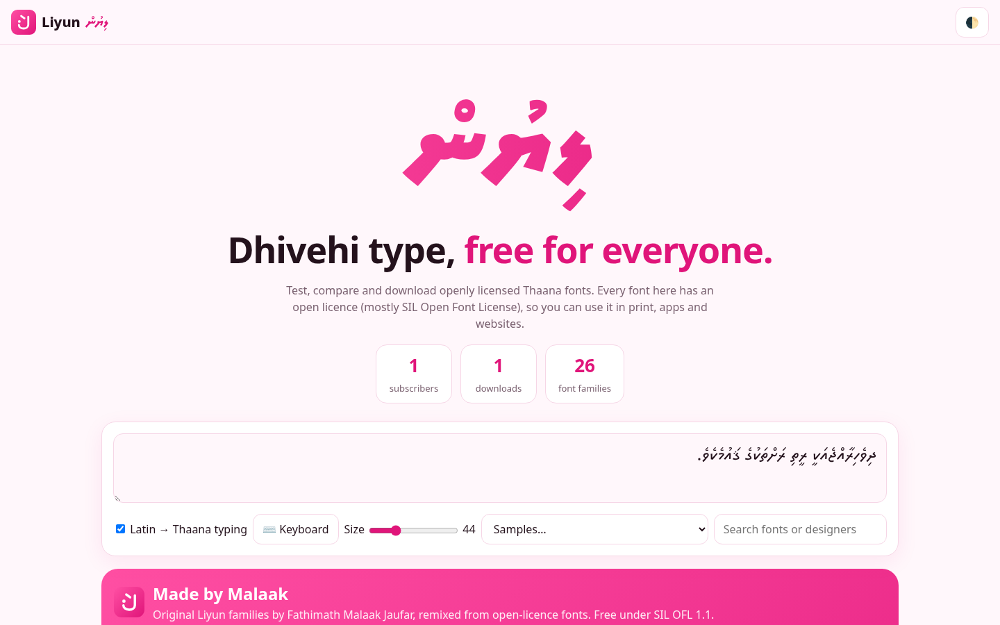

# Liyun · Free Dhivehi fonts

Free, openly licensed Dhivehi (Thaana) fonts, with a live type tester, a Latin-to-Thaana keyboard, and web CSS snippets.

**Live site:** https://reseachrandomv.github.io/liyun/

## License

The site is [MIT](LICENSE). The fonts keep the licence already included with each family, usually the [SIL Open Font License 1.1](fonts/OFL.txt). GNU FreeSerif uses [GPLv3+ with the font exception](fonts/gnu-freeserif/COPYING.txt).
